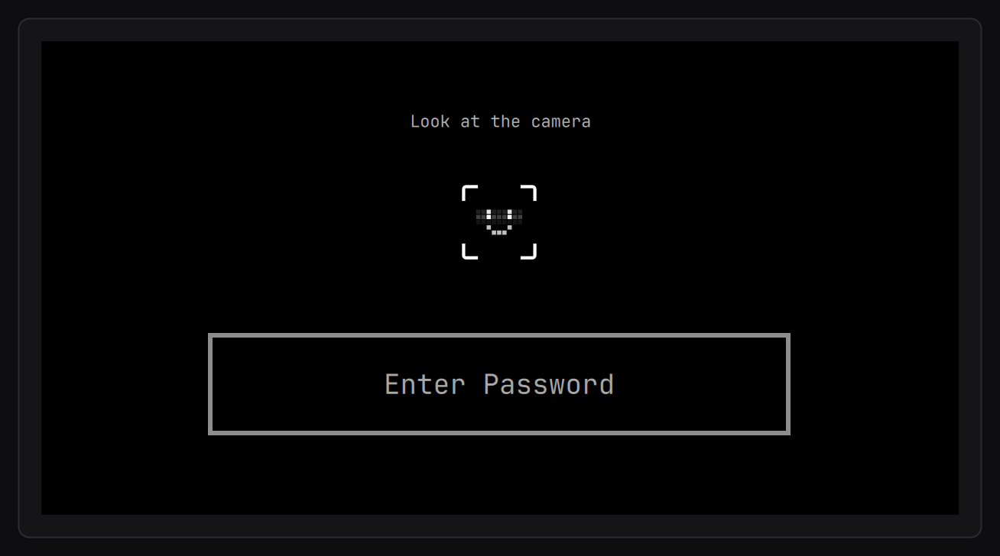
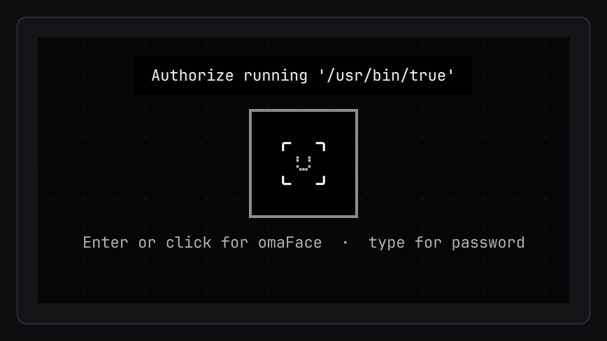
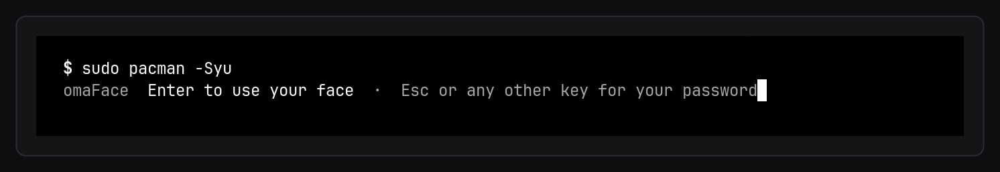
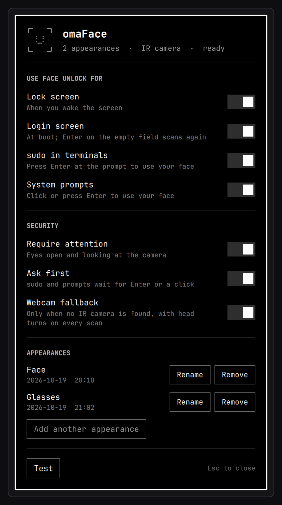
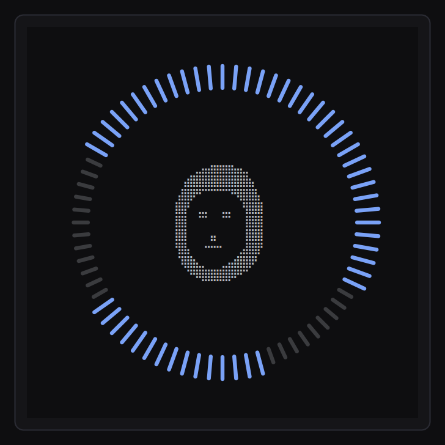
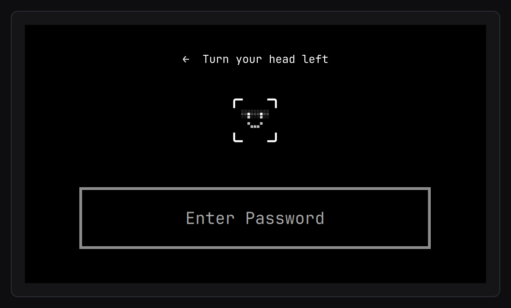
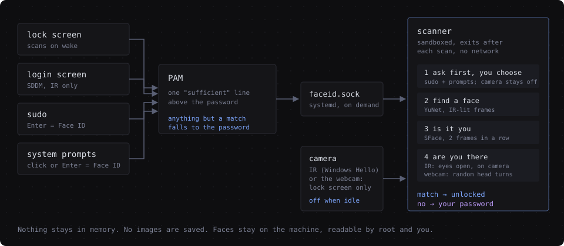

# omaFace

Face unlock for [Omarchy](https://omarchy.org) 4, made by the community. Glance at the camera to unlock
the lock screen, sign in at the login screen, answer `sudo`, or approve system
prompts. Your password keeps working everywhere, always.

<p align="center">
  
</p>

It looks and moves like the rest of Omarchy: the lock screen and polkit dialog
are Omarchy's own, with a mark made of square pixels that scans, turns into a
check when it knows you, and shakes when it does not.

<p align="center">
  
</p>

As a package, built from this repository (the AUR listing follows once AUR
registration reopens):

```
git clone https://github.com/L0adn9/omaface ~/.local/src/omaface
cd ~/.local/src/omaface/packaging/aur && makepkg -si
omaface setup
```

(Coming from a git install? `omaface uninstall --keep-data` first; your
faces and settings carry over.)

Or installed straight from git:

```
git clone https://github.com/L0adn9/omaface ~/.local/src/omaface
cd ~/.local/src/omaface && ./install.sh
```

The package only puts files in place. `omaface setup` (run as your user; the
git installer runs it for you) is what switches omaFace on: one line above the
password in sudo, polkit and the login screen, and the lock screen and polkit
dialog handed to the omaFace plugin. Then open **omaFace** from the app launcher (or run `omaface settings`) and
choose **Set up omaFace**.

## What you need

* **Omarchy 4** or newer (the Quickshell lock screen).
* **A camera.** omaFace looks for an infrared (Windows Hello) camera first and
  uses it when there is one. A laptop without one uses its regular webcam, for
  everything, with liveness and attention checks on every scan (see
  [Laptops without an IR camera](#laptops-without-an-ir-camera)). This is
  automatic; you do not need to know which camera you have.
* About 120 MB for OpenCV if it is not installed yet. pacman lists what it
  adds and asks first.

## How it looks

<table>
  <tr>
    <td width="50%"></td>
    <td width="50%"></td>
  </tr>
  <tr>
    <td><sub>System prompts wait for you: click or Enter for omaFace, or just type the password.</sub></td>
    <td><sub><code>sudo</code> asks the same way in the terminal. The camera stays off until you choose.</sub></td>
  </tr>
  <tr>
    <td></td>
    <td><br><br></td>
  </tr>
  <tr>
    <td><sub>Settings: where omaFace is used, attention, ask first, appearances.</sub></td>
    <td><sub>Enrolling (the preview is braille, drawn here), and webcam mode's optional head-turn check.</sub></td>
  </tr>
</table>

## Where it is used

| Place  | When it scans | Notes |
|--------|---------------|-------|
| lock   | on activity after locking (key, pointer, a click on the mark), and right after waking from sleep | a lock you just asked for is not undone while you still sit there |
| login  | when the login screen appears; Enter on the empty field scans again | SDDM as the login manager, and a face enrolled |
| sudo   | after you press Enter at the omaFace prompt | any other key goes to the password; typed keys are not echoed while it looks |
| polkit | after you click the mark or press Enter | typing goes straight to the password field, nothing lost |

Each one can be switched off in the settings window or with `omaface disable`.

### Ask first

Unlocking the screen is something you are already doing when you sit down, so
the lock and login screens scan by themselves. `sudo` and system prompts
approve changes to the system, so there omaFace waits until you ask for it:
Enter in the terminal, Enter or a click in the dialog. Until then the camera
stays off; type instead and it uses the password. Dismissing the prompt ends
the wait at once, and after 30 seconds without a choice it falls back to the
password. (`omaface set confirm off` scans right away instead.)

### Require attention

On by default with an IR camera. omaFace only unlocks when **both eyes are
open and looking at the camera**, so it does not open for someone asleep,
looking at their phone, or turned away.

It uses the IR light itself. The light sits beside the lens, so an eye looking
into the camera reflects it straight back off the retina and the whole pupil
glows (the same effect as red-eye in a flash photo). Closed, lowered or averted
eyes show no glow. The head's angle, compared with how it sat when you
enrolled, catches looking up or away.

* Glance at the camera; the lock screen says so while it scans.
* The glow only shows within a few degrees of the camera, so looking at the
  middle or bottom of the screen usually does not count.
* Eyes closed, looking at the keyboard, squinting, or looking to the side do
  not unlock. A miss never counts toward the lockout.
* Some glasses throw glare over the eyes. If omaFace recognizes you
  (`omaface test` says so) but never unlocks, turn attention off in Settings.

## Laptops without an IR camera

When no IR camera is found, omaFace uses the regular webcam, for everything:
the lock screen, the login screen, `sudo` and system prompts. It works the same
way: glance at the screen and it unlocks. A webcam sees what your eyes see, so
a photo or a phone screen showing your face looks like you; three checks run on
the same frames, with nothing for you to do:

* **Is it a live face.** Two small anti-spoofing models (Minivision's
  Silent-Face, trained to tell live faces from prints and screens) score every
  frame. A photo or a screen may fool them on a lucky frame, so it takes a run
  of about eight good frames in a row (a third of a second).
* **Are you paying attention.** With Require attention on, a gaze model
  checks where your eyes point, against where they pointed at the screen when
  you enrolled, and Google's MediaPipe eye model checks the eyelids are open:
  eyes closed, eyes on your phone or your lap, or the head turned away do not
  unlock; anywhere on the screen does, down to its bottom edge.
* **Is it you**, with a stricter match threshold than the IR camera.

Measured on a laptop webcam: the user unlocked in about 0.4 seconds; eyes
closed, eyes on a phone held low or at the chest, a photo of the user on a
phone (close, far, tilted) and a video of the user on a phone never unlocked. That is one webcam in one room; lighting matters, and
in a dark room the webcam simply falls back to the password.

More, still with nothing to do:

* **`sudo` and system prompts always ask first** with a webcam: nothing scans
  until you press Enter or click, even if ask first is switched off.
* **Three failed tries and it waits for your password**, until you use it once.
* Webcam and IR appearances are kept apart.

It is still weaker than an IR camera: a good enough video or mask might get
past a passive check. For the strictest setting, **Head turns** in Settings adds
a few random head turns to every scan (a recording cannot follow a sequence it
does not know); it is off by default because it is slower than typing. The
switch **Webcam fallback** turns webcam mode off; an IR camera, when there is
one, is always used instead.

## How it works

<p align="center">
  
</p>

* **Nothing stays in memory.** The scanner starts when something asks, looks
  for a few seconds and exits (about 100 MB while scanning, nothing at rest).
  No daemon. OpenCL is off, so a discrete GPU is never woken.
* **The camera turns off as soon as the answer is known**, or within about a
  fifth of a second when a prompt is cancelled or the settings window closes.
* **The password always works.** Each omaFace PAM line is `sufficient` and
  sits directly above the password line: success skips the password, and
  anything else (no face, wrong face, timeout, lid closed, camera busy, engine
  broken, service stopped) falls straight through to it. Omarchy's fingerprint
  lines, if you use them, keep their place above it.
* **Everything stays on the machine.** No network access, no images saved.
  Faces are YuNet detections turned into SFace templates, fully offline.
* **The shell plugin `io.github.l0adn9.omaface`** replaces `omarchy.lock` and
  `omarchy.polkit`. It is built on your machine from Omarchy's installed files
  plus small anchored patches (`tools/patches.py`), not shipped as a frozen
  copy, and the build refuses to produce a half-patched lock screen.

## Security, honestly

* The IR camera ignores phone and monitor screens (they give off no infrared),
  and attention needs live eyes reflecting the camera's own light. There is
  still no depth sensor: a good enough infrared-visible replica, or a close
  relative, might pass. Treat it as convenient, not as strong as your
  password. `omaface set threshold 0.6` makes matching stricter (default 0.50;
  `omaface test` shows your scores).
* With an IR camera, five scans that see a face that is not yours pause Face
  ID for five minutes. With a webcam, three failed tries pause it until the
  password is used. The password always works.
* Face templates are root-owned (`/var/lib/omaface/<user>`, mode 0640, group =
  your user), so nothing running as you can swap in another face. Only root
  can enroll, rename or remove.
* `sudo` and polkit only accept a face while you have an active local session,
  and only after you ask for omaFace. `sudo` from SSH or another remote session
  never uses the camera.
* The scan service runs with no capabilities, no network, a read-only
  filesystem apart from `/run/omaface`, and access to video devices only.

## Commands

```
omaface                     status
omaface setup               switch omaFace on for you (the git installer runs it)
omaface settings            the omaFace window
omaface enroll              add your face (up to 3 appearances, e.g. with glasses)
omaface test                look at the camera and see the scores
omaface rename <N> <name>   rename an appearance
omaface remove <N|all>      remove one, or all
omaface enable|disable lock login sudo polkit
omaface set attention on|off
omaface set confirm on|off  ask first for sudo and system prompts
omaface set rgb_fallback on|off
omaface cameras             cameras on this machine and which one is used
omaface emitter             check that the IR light comes on
omaface doctor              check every part
omaface sync                rebuild the shell plugin (after updates it happens by itself)
omaface uninstall           put everything back the way Omarchy had it
```

## Troubleshooting

* **No camera found**: `omaface cameras`. If your IR camera is listed but not
  picked: `omaface set device /dev/videoN`.
* **"No face found" all the time with an IR camera**: `omaface emitter`. Many
  Lenovo, Dell and HP laptops keep the IR light off until it is switched on
  once: `omarchy pkg aur add linux-enable-ir-emitter`, then
  `sudo linux-enable-ir-emitter configure`.
* **Recognized but never unlocks**: look into the camera; if it still fails,
  `omaface test` says whether it saw your eyes. Try `omaface set attention off`.
* **Lock screen misbehaving**: `omarchy plugin disable io.github.l0adn9.omaface` (brings
  back `omarchy.lock`), `omarchy plugin enable omarchy.polkit`, then
  `omarchy restart shell`. The same commands work from a TTY (Ctrl+Alt+F3).
* **Login screen misbehaving**: `sudo rm /etc/sddm.conf.d/20-omaface.conf`
  returns to Omarchy's theme. SDDM also falls back to its built-in theme on a
  broken one.
* `omaface doctor` checks every part and names the fix.

## Updates

* **OpenCV upgrade**: the git install has a pacman hook that rebuilds the
  engine and swaps it in only after it passes a self-test. The package is
  rebuilt like any AUR package; until then omaFace steps aside and the
  password works, and `omaface doctor` says so.
* **Omarchy update**: a post-update hook runs `omaface doctor --after-update`.
  If Omarchy changed its lock screen or polkit dialog, the plugin is rebuilt
  from the new files; if that cannot be done cleanly, the working copy stays.
  If the plugin ever fails to load, Omarchy's own lock screen and polkit
  dialog are switched back on, so you are never left without a lock.
* **omaFace itself**: the package updates with the rest of the system, and
  the plugin is rebuilt after the next `omarchy update` (or now: `omaface
  sync`). From git: `git pull && ./install.sh`. Enrolled faces and settings
  are kept either way.

## Files

The package installs under `/usr`, the git install under `/usr/local`
(written `<prefix>` here); the git install's units live in `/etc/systemd`.

| Path | What |
|------|------|
| `<prefix>/lib/omaface/` | `omaface-engine`, `omaface-pam`, setup and teardown (git: also `rebuild`, `uninstall`) |
| `<prefix>/bin/omaface` | the command |
| `<prefix>/share/omaface/` | models (checksummed), plugin sources and build tool, default settings |
| `/usr/share/sddm/themes/omaface/` | the login theme |
| `omaface.socket`, `omaface@.service` | the scanner |
| `/usr/local/src/omaface/`, `/etc/pacman.d/hooks/omaface.hook` | git only: rebuilds the engine when OpenCV upgrades |

`omaface setup` adds:

| Path | What |
|------|------|
| `/etc/omaface/config` | places, attention, ask first, webcam, thresholds, timeouts |
| `/var/lib/omaface/` | enrolled faces, PAM backups |
| `/etc/pam.d/{sudo,polkit-1,sddm}` | one marked line each; `omaface-lock` |
| `/etc/sddm.conf.d/20-omaface.conf` | selects the login theme once a face is enrolled |
| `~/.config/omarchy/plugins/io.github.l0adn9.omaface/` | lock screen, polkit dialog, settings |
| `~/.config/omarchy/hooks/post-update.d/omaface` | runs the doctor after updates |

`omaface uninstall` takes all of that back out (`--keep-data` keeps enrolled
faces) and puts PAM, the lock screen, polkit and the login screen back as they
were. A git install's files go with it; the package is then removed with
`sudo pacman -Rns omaface`. Removing the package without it still takes
omaFace out of PAM and the login screen first.

## Credits

Built on [Omarchy](https://github.com/basecamp/omarchy) (MIT), the
[YuNet](https://github.com/opencv/opencv_zoo/tree/main/models/face_detection_yunet)
face detector (MIT) and
[SFace](https://github.com/opencv/opencv_zoo/tree/main/models/face_recognition_sface)
recognizer (Apache 2.0) from OpenCV Zoo, and [OpenCV](https://opencv.org). For
webcams: Minivision's
[Silent-Face](https://github.com/minivision-ai/Silent-Face-Anti-Spoofing)
anti-spoofing models (Apache 2.0, via
[yakhyo/face-anti-spoofing](https://github.com/yakhyo/face-anti-spoofing)),
Google's [MediaPipe](https://github.com/google-ai-edge/mediapipe) iris model
(Apache 2.0) and the
[yakhyo/gaze-estimation](https://github.com/yakhyo/gaze-estimation) gaze model
(MIT). See `NOTICE`. omaFace is MIT licensed.

Omarchy is a registered trademark of 37signals LLC. omaFace is an independent
community project, not affiliated with or endorsed by 37signals, the Omacom
Foundation or Apple.
