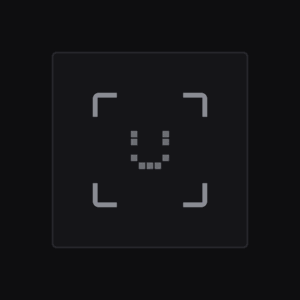

# Face ID for Omarchy

Face unlock for [Omarchy](https://omarchy.org) 4. Glance at the camera to unlock
the lock screen, sign in at the login screen, answer `sudo`, or approve system
prompts. Your password keeps working everywhere, always.

<p align="center">
  
</p>

It looks and moves like the rest of Omarchy: the lock screen and polkit dialog
are Omarchy's own, with a mark made of square pixels that scans, turns into a
check when it knows you, and shakes when it does not.

<p align="center">
  
</p>

```
git clone https://github.com/L0adn9/omarchy-faceid ~/.local/src/omarchy-faceid
cd ~/.local/src/omarchy-faceid && ./install.sh
```

Then open **Face ID** from the app launcher (or run `faceid settings`) and
choose **Set up Face ID**.

## What you need

* **Omarchy 4** or newer (the Quickshell lock screen).
* **A camera.** An infrared (Windows Hello) camera gets everything below. A
  laptop without one gets the regular webcam for the lock screen only, with a
  head-turn check (see [Laptops without an IR camera](#laptops-without-an-ir-camera)).
  The installer works out which one you have; you do not need to know.
* About 120 MB for OpenCV if it is not installed yet. The installer lets
  pacman list what it adds and asks first.

## How it looks

<table>
  <tr>
    <td width="50%"></td>
    <td width="50%"></td>
  </tr>
  <tr>
    <td><sub>System prompts wait for you: click or Enter for Face ID, or just type the password.</sub></td>
    <td><sub><code>sudo</code> asks the same way in the terminal. The camera stays off until you choose.</sub></td>
  </tr>
  <tr>
    <td></td>
    <td><br><br></td>
  </tr>
  <tr>
    <td><sub>Settings: where Face ID is used, attention, ask first, appearances.</sub></td>
    <td><sub>Enrolling (the preview is braille, drawn here), and webcam mode asking for a head turn.</sub></td>
  </tr>
</table>

## Where it is used

| Place  | When it scans | Notes |
|--------|---------------|-------|
| lock   | on activity after locking (key, pointer, a click on the mark), and right after waking from sleep | a lock you just asked for is not undone while you still sit there |
| login  | when the login screen appears; Enter on the empty field scans again | IR camera, SDDM as the login manager, and a face enrolled |
| sudo   | after you press Enter at the Face ID prompt | any other key goes to the password; typed keys are not echoed while it looks |
| polkit | after you click the mark or press Enter | typing goes straight to the password field, nothing lost |

Each one can be switched off in the settings window or with `faceid disable`.

### Ask first

Unlocking the screen is something you are already doing when you sit down, so
the lock and login screens scan by themselves. `sudo` and system prompts
approve changes to the system, so there Face ID waits until you ask for it:
Enter in the terminal, Enter or a click in the dialog. Until then the camera
stays off; type instead and it uses the password. Dismissing the prompt ends
the wait at once, and after 30 seconds without a choice it falls back to the
password. (`faceid set confirm off` scans right away instead.)

### Require attention

On by default with an IR camera. Face ID only unlocks when **both eyes are
open and looking at the camera**, so it does not open for someone asleep,
looking at their phone, or turned away.

It uses the IR light itself. The light sits beside the lens, so an eye looking
into the camera reflects it straight back off the retina and the whole pupil
glows (the same effect as red-eye in a flash photo). Closed, lowered or averted
eyes show no glow. The head's angle, compared with how it sat when you
enrolled, catches looking up or away.

* Glance at the camera; the lock screen says so while it scans.
* The glow only shows within a few degrees of the camera, so looking at the
  middle or bottom of the screen usually does not count.
* Eyes closed, looking at the keyboard, squinting, or looking to the side do
  not unlock. A miss never counts toward the lockout.
* Some glasses throw glare over the eyes. If Face ID recognizes you
  (`faceid test` says so) but never unlocks, turn attention off in Settings.

## Laptops without an IR camera

A regular webcam sees what your eyes see, so a photo or a phone screen showing
your face looks like you. Face ID still works with one, with limits that keep
it safe:

* **Lock screen only.** `sudo`, system prompts and the login screen keep using
  your password; the scanner itself refuses them with a webcam.
* **A random head-turn sequence on every unlock.** After it recognizes you it
  asks for three moves (left, right, back to the camera), each after a random
  pause and within a couple of seconds. A real head turning moves the nose
  against the eyes; a photo or a screen tilted the same way does not, because
  it is flat. A recording cannot follow a sequence it does not know, and the
  face back at the camera has to match again.
* **Three failed tries and it waits for your password**, until you use it once.
* Webcam and IR appearances are kept apart, with a stricter match threshold
  for the webcam.

Tested with a photo of the user on a phone: it was recognized as the user, and
refused by the head-turn check every time.

It is still weaker than an IR camera: someone with videos of you turning each
way, switched live in front of the camera, might get past it. The installer
picks this mode by itself when there is no IR camera; the switch "Use the
webcam if there is no IR camera" in Settings turns it on or off.

## How it works

<p align="center">
  
</p>

* **Nothing stays in memory.** The scanner starts when something asks, looks
  for a few seconds and exits (about 100 MB while scanning, nothing at rest).
  No daemon. OpenCL is off, so a discrete GPU is never woken.
* **The camera turns off as soon as the answer is known**, or within about a
  fifth of a second when a prompt is cancelled or the settings window closes.
* **The password always works.** Each Face ID PAM line is `sufficient` and
  sits directly above the password line: success skips the password, and
  anything else (no face, wrong face, timeout, lid closed, camera busy, engine
  broken, service stopped) falls straight through to it. Omarchy's fingerprint
  lines, if you use them, keep their place above it.
* **Everything stays on the machine.** No network access, no images saved.
  Faces are YuNet detections turned into SFace templates, fully offline.
* **The shell plugin `l0adn9.faceid`** replaces `omarchy.lock` and
  `omarchy.polkit`. It is built on your machine from Omarchy's installed files
  plus small anchored patches (`tools/patches.py`), not shipped as a frozen
  copy, and the build refuses to produce a half-patched lock screen.

## Security, honestly

* The IR camera ignores phone and monitor screens (they give off no infrared),
  and attention needs live eyes reflecting the camera's own light. There is
  still no depth sensor: a good enough infrared-visible replica, or a close
  relative, might pass. Treat it as convenient, not as strong as your
  password. `faceid set threshold 0.6` makes matching stricter (default 0.50;
  `faceid test` shows your scores).
* With an IR camera, five scans that see a face that is not yours pause Face
  ID for five minutes. With a webcam, three failed tries pause it until the
  password is used. The password always works.
* Face templates are root-owned (`/var/lib/faceid/<user>`, mode 0640, group =
  your user), so nothing running as you can swap in another face. Only root
  can enroll, rename or remove.
* `sudo` and polkit only accept a face while you have an active local session,
  and only after you ask for Face ID. `sudo` from SSH or another remote session
  never uses the camera.
* The scan service runs with no capabilities, no network, a read-only
  filesystem apart from `/run/faceid`, and access to video devices only.

## Commands

```
faceid                     status
faceid settings            the Face ID window
faceid enroll              add your face (up to 3 appearances, e.g. with glasses)
faceid test                look at the camera and see the scores
faceid rename <N> <name>   rename an appearance
faceid remove <N|all>      remove one, or all
faceid enable|disable lock login sudo polkit
faceid set attention on|off
faceid set confirm on|off  ask first for sudo and system prompts
faceid set rgb_fallback on|off
faceid cameras             cameras on this machine and which one is used
faceid emitter             check that the IR light comes on
faceid doctor              check every part
faceid uninstall           put everything back the way Omarchy had it
```

## Troubleshooting

* **No camera found**: `faceid cameras`. If your IR camera is listed but not
  picked, set `device=/dev/videoN` in `/etc/faceid/config`.
* **"No face found" all the time with an IR camera**: `faceid emitter`. Many
  Lenovo, Dell and HP laptops keep the IR light off until it is switched on
  once: `omarchy pkg aur add linux-enable-ir-emitter`, then
  `sudo linux-enable-ir-emitter configure`.
* **Recognized but never unlocks**: look into the camera; if it still fails,
  `faceid test` says whether it saw your eyes. Try `faceid set attention off`.
* **Lock screen misbehaving**: `omarchy plugin disable l0adn9.faceid` (brings
  back `omarchy.lock`), `omarchy plugin enable omarchy.polkit`, then
  `omarchy restart shell`. The same commands work from a TTY (Ctrl+Alt+F3).
* **Login screen misbehaving**: `sudo rm /etc/sddm.conf.d/20-faceid.conf`
  returns to Omarchy's theme. SDDM also falls back to its built-in theme on a
  broken one.
* `faceid doctor` checks every part and names the fix.

## Updates

* **OpenCV upgrade**: a pacman hook rebuilds the engine and swaps it in only
  after it passes a self-test.
* **Omarchy update**: a post-update hook runs `faceid doctor --after-update`.
  If Omarchy changed its lock screen or polkit dialog, the plugin is rebuilt
  from the new files; if that cannot be done cleanly, the working copy stays.
  If the plugin ever fails to load, Omarchy's own lock screen and polkit
  dialog are switched back on, so you are never left without a lock.
* **Face ID itself**: `git pull && ./install.sh`. Enrolled faces and settings
  are kept.

## Files

| Path | What |
|------|------|
| `/usr/local/lib/faceid/` | `faceid-engine`, `faceid-pam`, `rebuild`, `uninstall` |
| `/usr/local/bin/faceid` | the command |
| `/usr/local/share/faceid/` | models (checksummed), plugin sources and build tool |
| `/usr/local/src/faceid/` | engine sources for the OpenCV rebuild hook |
| `/etc/faceid/config` | places, attention, ask first, webcam, thresholds, timeouts |
| `/var/lib/faceid/` | enrolled faces, PAM backups |
| `/etc/systemd/system/faceid.socket`, `faceid@.service` | the scanner |
| `/etc/pam.d/{sudo,polkit-1,sddm}` | one marked line each; `omarchy-lock-face` |
| `/usr/share/sddm/themes/omarchy-faceid/`, `/etc/sddm.conf.d/20-faceid.conf` | login |
| `/etc/pacman.d/hooks/faceid.hook` | rebuilds the engine when OpenCV upgrades |
| `~/.config/omarchy/plugins/l0adn9.faceid/` | lock screen, polkit dialog, settings |
| `~/.config/omarchy/hooks/post-update.d/faceid` | runs the doctor after updates |

`faceid uninstall` removes all of it (`--keep-data` keeps enrolled faces) and
puts PAM, the lock screen, polkit and the login screen back as they were.

## Credits

Built on [Omarchy](https://github.com/basecamp/omarchy) (MIT), the
[YuNet](https://github.com/opencv/opencv_zoo/tree/main/models/face_detection_yunet)
face detector (MIT) and
[SFace](https://github.com/opencv/opencv_zoo/tree/main/models/face_recognition_sface)
recognizer (Apache 2.0) from OpenCV Zoo, and [OpenCV](https://opencv.org).
See `NOTICE`. Face ID for Omarchy is MIT licensed, and is not affiliated with
Apple or with Omarchy.
